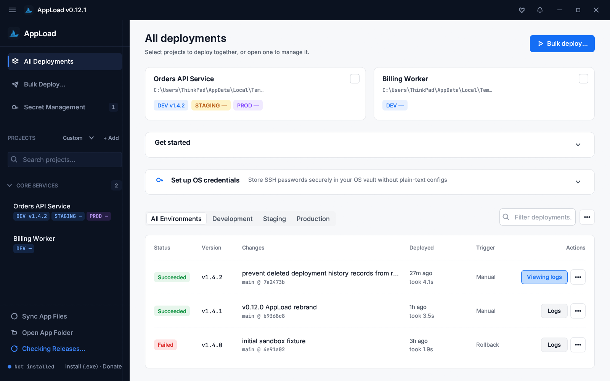
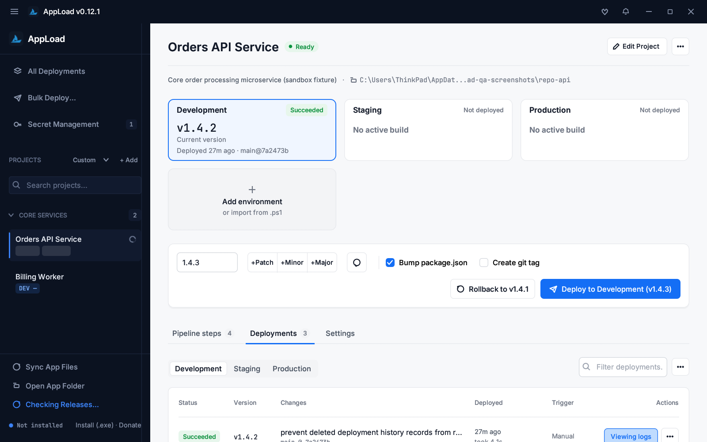
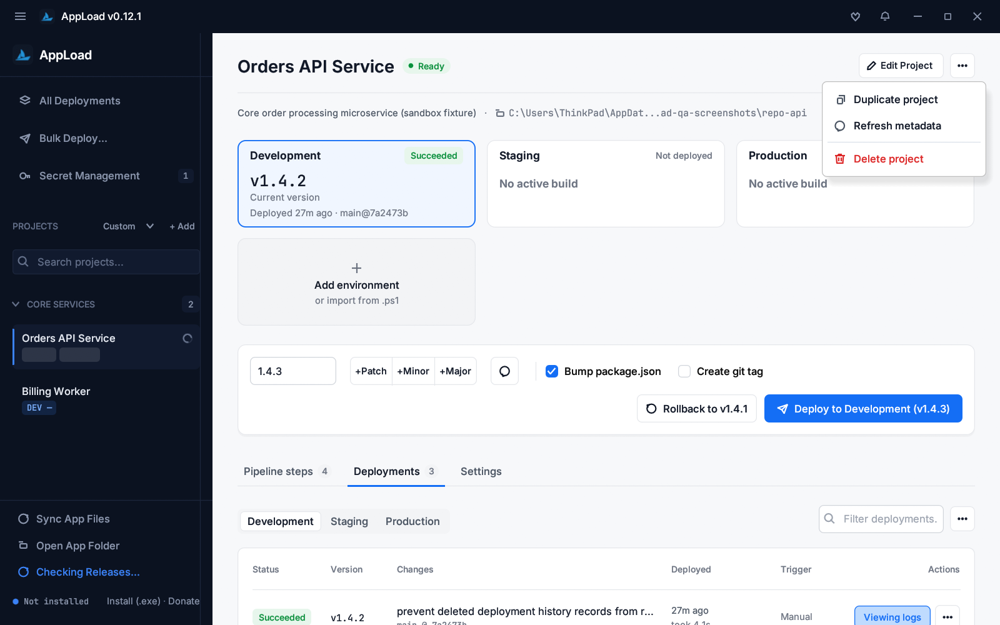
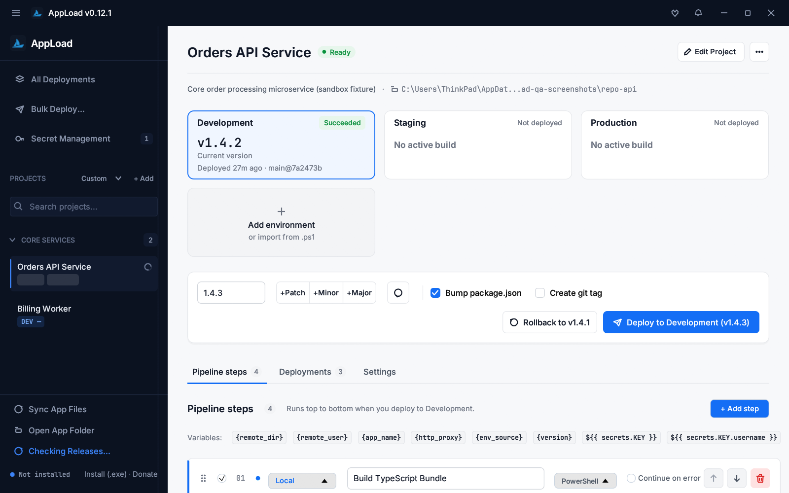
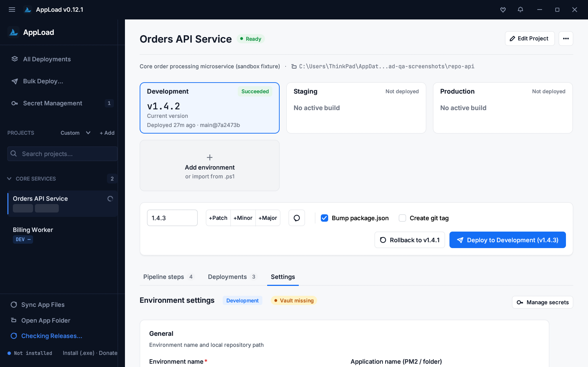
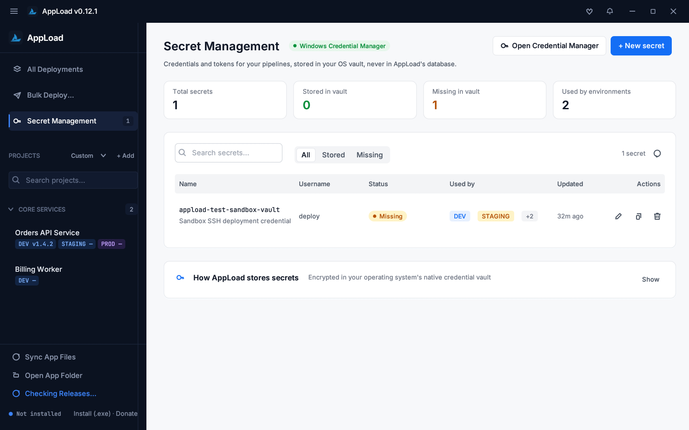

# AppLoad v0.12.1 — Full Sandbox QA Report (Brief 008 & Brief 009 + Addendum A)

- **Version Tested:** `0.12.1`
- **Branch:** `fix/delete-history-record` (from `main` `b9368c8`)
- **Execution Mode:** 100% Sandboxed (`APPLOAD_SANDBOX_ROOT`)
- **Automated Test Count:** **134 passed, 0 failed** (`124` unit/UI/kittest tests + `3` integration tests + `5` storage migration E2E tests + `2` v0.11 compatibility updater tests; `1` real-recovery-folder test intentionally ignored per sandbox rules)

---

## 1. Sandbox & Safety Compliance

1. **`APPLOAD_SANDBOX_ROOT` Enforced Everywhere:** Every test (`TestSandbox`) and every screenshot/binary invocation ran strictly under temporary sandbox directories. Adrian's live `%LOCALAPPDATA%\appload`, `%LOCALAPPDATA%\Programs\AppLoad`, Start Menu/Desktop shortcuts, and `orca\briefs\shiply\recovery` were never read, modified, or signaled.
2. **Sandbox-Scoped Single-Instance Mutex:** `src/single_instance.rs` appends a deterministic FNV-1a 64-bit hash of the normalized `APPLOAD_SANDBOX_ROOT` path (`Local\AppLoad.SingleInstance.Sandbox.<hash>`) and disables `focus_existing_appload_window()` in sandbox mode, ensuring complete independence from Adrian's live running `appload.exe`.
3. **Synthetic Projects & Fake `ssh`/`scp` Executor Target:** All deploy tests use temporary Git repositories with synthetic `package.json` and `dist/` artifacts. Remote SSH/SCP execution is tested via compiled fake `ssh.exe` and `scp.exe` binaries prepended to `PATH` (recording `argv` and simulating both exit `0` and exit `1`) alongside frozen command-construction characterization tests.
4. **Windows Credential Manager Guard (`appload-test-<uuid>`):** `src/credentials.rs` enforces a hard runtime guard in sandbox/test mode refusing any vault key that does not start with `appload-test-`, paired with `TestVaultCredentialGuard` (RAII drop cleanup).

---

## 2. Bugs Found and Fixed (One Commit Each)

| # | Commit | Summary & Root Cause | Fix & Verification |
|---|--------|----------------------|--------------------|
| 1 | `7a2473b` | **Brief 008 — Deleted deployment history record stays or reappears after success toast:** (a) `remove_deployment` mutated memory first and called `save_all_to_db`, which performed full-table `DELETE FROM deployments` + re-insert from memory (allowing stale second instances or background saves to resurrect deleted rows); (b) `last_state_mtime` was captured *before* `conn` closed and flushed WAL/SHM on Windows, causing `sync_from_app_directory()` to reload stale snapshots; (c) `confirm_delete.rs` showed `"Deployment record deleted"` unconditionally even on SQLite lock errors; (d) no single-instance guard existed. | `remove_deployment`, `clear_deployment_history`, and `remove_secret_metadata` now execute targeted `DELETE` in SQLite first (with 5s `busy_timeout`), close `conn` before recording `last_state_mtime`, and return `Result<..., String>`. Replaced full-table rewrites in `save_to` with incremental upserts/deletes (`save_incremental_to_db`). Added `src/single_instance.rs` mutex guard. Verified by 4 regression tests (`test_bug_008_*` and `test_confirm_delete_deployment_shows_error_toast_on_sqlite_failure_and_success_on_ok`). |
| 2 | `e147e59` | **Brief 009 Addendum A — Project header `"⋯"` button does nothing on left-click & uses Unicode glyph icons:** `src/ui/views/project_workspace.rs` used `more_resp.context_menu(...)`, which in `egui` only opens on secondary (right) click, and rendered Unicode glyphs (`⧉`, `↻`, `🗑`). Other `"⋯"` buttons used `PopupCloseBehavior::CloseOnClick` without consistent right-aligned anchoring or `OutlineIcon` items. | Added shared `kit::overflow_menu` and `kit::overflow_menu_item` in `src/ui/kit.rs` (opens on left-click and right-click via `toggle_popup` + `popup_below_widget` with `CloseOnClickOutside`, right-aligned below button, 32px item height with `OutlineIcon` + `Typo::Label`, closes on item click, `Esc`, and outside click). Applied to Project Header, Deployments Toolbar, Desktop History Rows, and Mobile/Stacked History Rows. Verified by `test_qa_addendum_a_overflow_menus_left_click_item_click_esc_and_click_outside`. |
| 3 | `d55d2ca` | **QA Finding — Replacing an active/error toast in `confirm_delete.rs` did not reset `status_banner_time`:** `confirm_delete.rs` assigned `self.status_banner = Some(...)` directly without updating `self.status_banner_time` when replacing an existing banner, causing the new toast to auto-dismiss prematurely on the next frame if the prior banner was >4s old. | Updated `confirm_delete.rs` to call `self.set_status_banner(...)` and ensured `set_status_banner` in `src/ui/app.rs` always resets `self.status_banner_time = Some(Instant::now())`. Verified in `test_confirm_delete_deployment_shows_error_toast_on_sqlite_failure_and_success_on_ok` and `test_qa_area_05_06_07_08_history_secrets_overview_and_ui_regressions`. |

---

## 3. Full QA Test Matrix (Areas 1–10 + Addendum A)

| Area | Feature / Test Case | Status | Evidence (Automated Test / Screenshot) |
|------|---------------------|--------|----------------------------------------|
| **1. Projects** | Add project manually; auto-import from `deploy-*.ps1` (with siblings); edit; duplicate; delete (with confirm); groups (set/create, collapse); sidebar sort & search; right-click context menu actions | **PASS** | `ui::tests::qa_v0121_matrix_tests::test_qa_area_01_projects_full_lifecycle_and_kittest`, `ps1_importer::tests::test_import_project_from_ps1_file_auto_fills_project_and_environments`, `ui::tests::context_menu_tests::test_sidebar_custom_context_menu_viewport_flip_and_actions`, `ui::tests::sidebar_tests::*` |
| **Addendum A** | Project header `"⋯"`, Deployments toolbar `"⋯"`, Desktop history row `"⋯"`, and Mobile history row `"⋯"`: **left-click opens menu**, item click runs action & closes menu, `Esc` closes menu, click outside closes menu; `OutlineIcon` icons (`Copy`, `Refresh`, `Trash`, `RotateCcw`) | **PASS** | `ui::tests::qa_v0121_matrix_tests::test_qa_addendum_a_overflow_menus_left_click_item_click_esc_and_click_outside`, Screenshot `docs/qa/03-project-header-overflow-menu.png` |
| **2. Environments** | Add/clone environment; edit every field in Settings cards (`name`, `app_name`, `servers`, `remote_user`, `vault_target`, `remote_dir`, `env_source`, `http_proxy`); Verify vault target; Set secret; delete environment (Danger zone) | **PASS** | `ui::tests::qa_v0121_matrix_tests::test_qa_area_02_and_03_environments_and_pipeline_steps`, `domain::tests::test_add_and_remove_custom_environment`, Screenshot `docs/qa/05-server-settings.png` |
| **3. Pipeline Steps** | Add each type (`LocalCommand`, `VerifyLocalPath`, `TransferFiles`, `RemoteCommand`); edit name & command; variable chips copy exact placeholder text; enable/disable; reorder (up/down/drag); delete; "Continue on error" (`allow_failure`); shell selector (`PowerShell`/`CMD`/`Bash`) | **PASS** | `ui::tests::qa_v0121_matrix_tests::test_qa_area_02_and_03_environments_and_pipeline_steps`, `domain::tests::test_step_reordering`, `domain::tests::test_local_shell_serialization_and_defaults`, Screenshot `docs/qa/04-pipeline-steps.png` |
| **4. Deploy** | Successful local deploy of synthetic fixture project; failing step stops pipeline (`Failed`, logs captured, `package.json` not bumped); cancel mid-run (`Cancelled`); rollback to previous version (`is_rollback = true`); redeploy from history row; bulk deploy of 2 synthetic projects; version bump (`Patch`/`Minor`/`Major`) + `Bump package.json` edits fixture `package.json`; `Create git tag` creates `v<version>` tag in fixture repo; Sync version across environments; SSH/SCP steps against compiled fake `ssh`/`scp` on `PATH` | **PASS** | `ui::tests::qa_v0121_matrix_tests::test_qa_area_04_deploy_local_fail_cancel_rollback_redeploy_bulk_and_fake_ssh_scp`, `executor::tests::test_run_local_deployment_pipeline_and_package_bump`, `executor::tests::test_failed_deployment_does_not_bump_package_json`, `ui::tests::view_tests::test_cancel_running_deployment_clears_busy_state` |
| **5. History & Console** | History table list, environment filter, search query, "Show more" pagination (`+10` / collapse to 5); view step logs; console expand/shrink height; Copy log; **delete a record (Brief 008 fix) stays deleted across 5 sync cycles and full app restart**; Clear history; running deployment cannot be deleted | **PASS** | `ui::tests::qa_v0121_matrix_tests::test_qa_area_05_06_07_08_history_secrets_overview_and_ui_regressions`, `storage::tests::test_bug_008_*`, `ui::tests::modal_tests::test_clear_deployment_history_preserves_running_deployments`, Screenshot `docs/qa/02-project-workspace-deployments.png` |
| **6. Secrets Page** | Create, edit/rotate, copy `${{ secrets.<key> }}` reference, delete (`appload-test-<uuid>` keys only with cleanup guard); status filter (`All`/`Stored`/`Missing`) and search; vault status refresh; guide toggle | **PASS** | `ui::tests::qa_v0121_matrix_tests::test_qa_area_05_06_07_08_history_secrets_overview_and_ui_regressions`, `ui::tests::secret_tests::test_secret_management_page_and_os_vault_roundtrip`, Screenshot `docs/qa/06-secret-management.png` |
| **7. All Deployments Overview** | Project cards, bulk selection checkboxes, bulk deploy modal entry, onboarding/guide collapse | **PASS** | `ui::tests::qa_v0121_matrix_tests::test_qa_area_05_06_07_08_history_secrets_overview_and_ui_regressions`, Screenshot `docs/qa/01-all-deployments-overview.png` |
| **8. Inputs & UI Regressions** | Text selection (drag, double-click word, Shift+click/arrow), vertical centering, no collapsed fields (version input, sidebar search, filter search); sidebar layout at `1920px` and `1000px` wide; collapsed rail; modals open/close (`Esc`/`Enter`); toasts auto-dismiss after 4s | **PASS** | `ui::tests::input_tests::*`, `ui::tests::theme_tests::*`, `ui::tests::modal_tests::*`, `ui::tests::qa_v0121_matrix_tests::test_qa_area_05_06_07_08_history_secrets_overview_and_ui_regressions` |
| **9. App Lifecycle** | First run with empty sandbox; restart persistence (projects, history, secrets survive); single instance within same sandbox refuses second lock; independence from Adrian's live running app; window title & version show `0.12.1` | **PASS** | `ui::tests::qa_v0121_matrix_tests::test_qa_area_09_and_10_lifecycle_version_0121_and_update_simulation`, `single_instance::tests::test_single_instance_mutex_blocks_second_acquire_until_dropped`, `storage::tests::test_first_time_install_is_empty_without_project_or_environment` |
| **10. Install & Update Paths** | v0.11.0 → v0.12.1 migration (copy-only, legacy byte-identical); v0.12.0 → v0.12.1 in-app update atomic binary replacement simulation with data intact; fresh install with `--install`; Check for Updates flow detecting `0.12.1` against local `latest.json` & GitHub API fixtures | **PASS** | `tests/storage_migration_e2e_test.rs`, `tests/updater_v011_compat_test.rs`, `installer::tests::test_install_and_auto_update_over_existing_version`, `ui::tests::qa_v0121_matrix_tests::test_qa_area_09_and_10_lifecycle_version_0121_and_update_simulation` |

---

## 4. Sandboxed GUI Screenshots (`docs/qa/`)

All screenshots were captured directly from `target\release\appload.exe` (v0.12.1) running inside `APPLOAD_SANDBOX_ROOT`:

1. **All Deployments Overview (`docs/qa/01-all-deployments-overview.png`)**
   
2. **Project Workspace & Deployment History (`docs/qa/02-project-workspace-deployments.png`)**
   
3. **Project Header Left-Click Overflow Menu — Addendum A (`docs/qa/03-project-header-overflow-menu.png`)**
   
4. **Pipeline Steps Configuration (`docs/qa/04-pipeline-steps.png`)**
   
5. **Environment Server Settings (`docs/qa/05-server-settings.png`)**
   
6. **Secret Management (`docs/qa/06-secret-management.png`)**
   

---

## 5. Items Using Fallback / Simulation & Reason

- **Remote SSH/SCP Target (Rule 3 Fallback Used):** Rather than spinning up a Docker OpenSSH container, remote SSH and SCP pipeline steps were tested using the documented Brief 009 Rule 3 fallback: frozen command-construction characterization tests (`test_characterization_build_ssh_command_frozen`, `test_characterization_build_scp_command_frozen`) plus an end-to-end executor test (`test_qa_area_04_deploy_local_fail_cancel_rollback_redeploy_bulk_and_fake_ssh_scp`) that compiles a standalone fake `ssh.exe`/`scp.exe` on `PATH`, records full `argv`, and verifies both exit code `0` (success) and exit code `1` (failure).
- **Live GitHub v0.12.1 Release Download (Rule 5):** Because `v0.12.1` is not published until `"GO RELEASE"` and Rule 5 forbids triggering live self-update replacement, the updater's `0.12.0 → 0.12.1` detection and atomic `.exe` replacement were verified against local `latest.json`/GitHub REST API fixtures and sandboxed `replace_executable_atomic` execution.

---

## 6. Verification Gates

- `cargo fmt --check`: **PASS** (0 diffs)
- `cargo clippy --all-targets -- -D warnings`: **PASS** (0 warnings)
- `cargo test`: **PASS** (`124` unit/UI tests + `3` integration tests + `5` migration E2E tests + `2` updater compat tests = **134 passed, 0 failed**)
- `cargo build --release`: **PASS** (`target\release\appload.exe` built cleanly)
